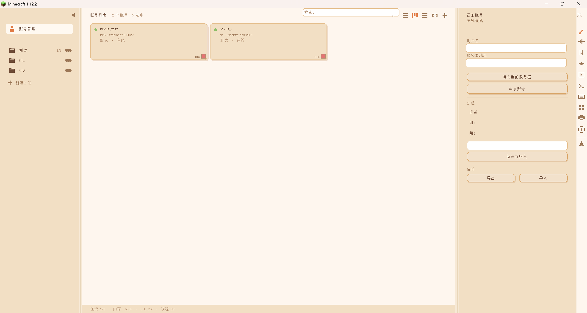

<div align="center">

<p><sub>ONE CLIENT. MANY PLAYERS.</sub></p>

<h1>Mythos Nexus</h1>


<h3>一个客户端，同时在线的每一双手。</h3>

<p>为 Minecraft 打造的单进程多开工作台<br />把多个机器人会话收进同一个游戏窗口，各自独立运行，随时切到任意一个。</p>

<p>


<a href="LICENSE"></a>
</p>

<p>
<a href="README.md">简体中文</a> ·
<a href="https://github.com/fenda1-1/MythosScript">MythosScript 主项目</a>
</p>

<p>
<a href="#账号管理">账号管理</a> ·
<a href="#会话隔离">会话隔离</a> ·
<a href="#实时视口">实时视口</a> ·
<a href="#自适应调度">自适应调度</a> ·
<a href="#代理与重连">代理与重连</a> ·
<a href="#与-mythosscript-联动">与 MythosScript 联动</a> ·
<a href="#开始使用">开始使用</a> ·
<a href="https://github.com/fenda1-1/MythosNexus/issues">反馈建议</a>
</p>

</div>

<br />

## 让一个客户端，同时握住很多双手

开多个客户端来多开，代价是每个实例一份渲染器、一份图形内存、一份客户端逻辑——机器先撑不住。**Mythos Nexus 换了一条路：把每个机器人会话放进同一个客户端进程，各自拥有独立的网络连接、世界、玩家、tick 线程与控制通道。**

宿主玩家的世界照常顺畅；后台的机器人在自己的线程上跑自己的世界，互不打扰。需要看谁的时候切过去，需要它们继续干活的时候回来做你的事。

<table>
<tr>
<td width="33%" valign="top">
<h3>01 / 隔离</h3>
<p>每个会话有自己的连接、世界、渲染上下文与 tick 线程。一个会话卡住或掉线，不会带走其他会话。</p>
</td>
<td width="33%" valign="top">
<h3>02 / 调度</h3>
<p>按优先级与运行状态分配 tick，按整进程 CPU 天花板自适应收缩，宿主永远优先。</p>
</td>
<td width="33%" valign="top">
<h3>03 / 观察</h3>
<p>在同一个界面里看到所有账号的实时画面与状态，随时接管任意一个。</p>
</td>
</tr>
</table>

## 账号管理

### 添加，分组，然后在同一个窗口里看到它们全部

左侧按分组导航，中间是账号卡片，右侧是编辑面板，最右一列是功能图标栏。搜索框覆盖账号名与服务器地址；卡片可以按默认、状态、名称或在线时长排序，也可以在瀑布流、分页与实时三种模式之间切换。

<a href="docs/images/maingui.png"></a>

<p><sub>MYTHOS NEXUS / 一个客户端 / 淡橘日光</sub></p>

| 能力 | 你可以如何使用 |
| :--- | :--- |
| **账号卡片** | 每个账号显示服务器、所属分组与在线状态，卡片上带该会话的 CPU 占用指示。 |
| **分组导航** | 按用途或场景分组，未使用的分组也可以保留；分组可配色在左侧区分。 |
| **搜索与排序** | 按名称或地址过滤，按状态或在线时长排序，账号多了也不会找不到。 |
| **备份与迁移** | 导出账号配置，在另一台机器导入，整套多开设置直接搬过去。 |
| **命令面板** | 按 `F1` 呼出全部命令，按键组合可以自定义，也可以双击录制。 |
| **右键菜单** | 在卡片上右键直接连接、挂载、分配代理、改分组，不必进设置。 |

> 默认按 `Z` 打开账号管理界面，再按一次 `Z` 关闭。主机游玩与后台运行互不冲突：界面关掉，机器人们继续在线。

## 会话隔离

### 同一个进程，互不混淆的世界

Minecraft 客户端天然是单例的——`Minecraft` 对象、`RenderGlobal`、`ParticleManager`、共享的 `Tessellator` 都只有一份。多个会话要共用它，就必须在切换时精确地换上下文。

Mythos Nexus 为此做了一层**会话上下文切换**：挂载某个会话时，把这个会话的世界、玩家、控制器、渲染观察实体、当前界面连同渲染器的世界引用一起写进共享单例，退出时原样换回。后台会话在自己的 tick 线程上运行，通过 ASM 改写让 tick 可达的类解析到自己的会话，而不是被挂载的那个。

| 隔离面 | 做法 |
| :--- | :--- |
| **网络** | 每个会话独立 `NetworkManager` 与 `NetHandlerPlayClient`，由注入点按连接路由回放数据包。 |
| **世界与实体** | 会话持有自己的 `WorldClient`、玩家实体与 `PlayerController`；切换时整体换入换出。 |
| **渲染** | 后台会话拥有一套独立的预览渲染器与视锥，不复用主世界的区块缓冲。 |
| **执行** | 每个后台会话一条独立 tick 线程，任务队列在该线程上串行消费。 |
| **界面** | 机器人会话派发登录包时关闭界面，不会误关宿主正在看的 GUI。 |

## 实时视口

### 不用切过去，就能看见它们在做什么

账号卡片可以切到实时模式，直接显示该会话渲染出的画面。每个预览都是独立的小尺寸帧缓冲，配一套自己的渲染器与视锥，因此不会引起主世界区块缓冲的重建，也不会在主渲染的取景切换里抖动。

- **瀑布流 / 分页 / 实时** 三种卡片模式，按当前要看的细节选择。
- **单会话时全速渲染**：只显示一个会话时按真实帧率走，不受轮转上限限制。
- **批量网格轮流刷新**：多个会话同时在卡片上显示时，按时间预算轮流渲染，保证界面不卡。
- **逐会话分辨率**：可以为每个账号单独指定预览尺寸，其余跟随全局设置。

## 自适应调度

### 让 15 个机器人和 1 个你，共用一份 CPU

每个后台机器人如果都按满 20 TPS 打世界 tick，两个以上就能把渲染线程饿到 1 fps。Mythos Nexus 用一个**自适应 tick 调度器**解决这件事：

1. 每客户端 tick 采样一次整进程 CPU 占用。
2. 用宿主的基线开销算出还剩多少余量。
3. 把余量按优先级曲线分配给各优先级的会话。
4. 有活跃路径的会话保持高优先级，空转的会话自动降到较低速率。

| 设置项 | 含义 |
| :--- | :--- |
| **整进程 CPU 上限** | 所有机器人加起来占用的天花板，默认 40%。 |
| **优先级曲线** | 六个优先级各自的速率权重，高优先级先拿到余量。 |
| **最低组速率** | 任何优先级都不会被压到 0，保证不会彻底停摆。 |
| **逐会话速率** | 单个账号可以覆盖全局值，需要的时候把某个账号钉在满速。 |

底部状态栏实时显示在线数、进程内存、CPU 占用与线程数，多开规模一眼可见。

## 代理与重连

### 每个账号，走自己的路

代理列表按账号绑定，支持 SOCKS5 与 HTTP。连接时把代理处理器插在网络管道最前面，这个会话的全部流量就从那条代理出去。

如果绑定的代理拒绝连接，**会话会依次尝试其他代理，最后退回直连**——一个挂掉的代理不该困住一个还能跑的机器人。每个账号可以单独设置自动重连、重连间隔与最大尝试次数；关闭客户端时在线的账号会被记下，下次启动自动恢复，整套多开阵容不用重新摆一遍。

| 能力 | 说明 |
| :--- | :--- |
| **代理绑定** | 一个账号一条线，多开时不同账号可以从不同出口出去。 |
| **故障转移** | 代理不可用时自动降级，日志里标出实际使用的那条。 |
| **自动重连** | 按账号开关，间隔与次数可调。 |
| **离线续连** | 记住上次在线状态，重启客户端后自动拉起来。 |
| **离线模式** | 不依赖正版验证，用任意用户名进入。 |

## 与 MythosScript 联动

Mythos Nexus 是 **[MythosScript](https://github.com/fenda1-1/MythosScript) 的多开底座**。两者的关系是分工而非重叠：

- **[Mythos Nexus](https://github.com/fenda1-1/MythosNexus)** 负责「多个会话同时存在并各自独立运行」——连接、世界、tick、代理与调度。
- **[MythosScript](https://github.com/fenda1-1/MythosScript)** 负责「会话里做什么」——动作录制、路径序列、节点图、数据包工作台与自动化能力。

<table>
<tr>
<td width="50%" valign="top">
<h3><a href="https://github.com/fenda1-1/MythosScript">MythosScript ↗</a></h3>
<p>可视化自动化工作台。动作录制、路径序列、节点图、变量与条件、数据包分析与 MCP 控制接口。</p>
<p><sub>会话里做什么 —— 由它决定。</sub></p>
</td>
<td width="50%" valign="top">
<h3><a href="https://github.com/fenda1-1/MythosNexus">Mythos Nexus ↗</a></h3>
<p>单进程多开会话运行时。连接、世界、tick 线程、代理与自适应调度。</p>
<p><sub>会话如何同时存在 —— 由它保证。</sub></p>
</td>
</tr>
</table>

装好两者后，账号界面里的脚本面板会列出 [MythosScript](https://github.com/fenda1-1/MythosScript) 的路径序列，可以针对当前选中的会话执行或停止，也可以把后台会话拉进来一起跑。[MythosScript](https://github.com/fenda1-1/MythosScript) 的 [MCP 控制接口](https://github.com/fenda1-1/MythosScript/blob/1.12.2/README_MCP.md)通过会话名路由，因此多个机器人各自都有独立的可控通道。

| 你想要的 | 装什么 |
| :--- | :--- |
| 只多开，跑固定流程 | 只装 Mythos Nexus |
| 多开 + 可视化编排自动化 | 两者都装 |
| 多开 + 让 AI 客户端驱动 | 两者都装，再接 MCP |

> [MythosScript](https://github.com/fenda1-1/MythosScript) 可以单独使用；Nexus 也可以单独使用，不装 [MythosScript](https://github.com/fenda1-1/MythosScript) 时脚本面板为空，多开与调度能力完整保留。

## 界面

### 深色、克制，为长时间盯着看而做

界面按 2 倍 GUI 缩放设计，与游戏自身的缩放设置无关，因此不同分辨率和窗口大小下布局保持一致。主题系统提供预设配色，也支持自定义强调色与背景。

| 面板 | 作用 |
| :--- | :--- |
| **账号** | 添加、编辑、分组、选中与连接。 |
| **状态** | 在线时长、生命值、附近实体等会话状况。 |
| **日志** | 每个会话的事件流，连接、掉线、代理切换都在这里。 |
| **代理** | 代理服务器列表与账号绑定。 |
| **脚本** | MythosScript 路径序列的执行与停止。 |
| **命令** | 全部命令一览，按键组合可改可录。 |
| **快捷键** | 编辑按键绑定，双击录制组合键。 |
| **主题** | 预设、新建、导入与配色微调。 |
| **Tick** | 自适应调度开关、CPU 上限与优先级曲线。 |
| **信息** | 版本、交流群与开源地址。 |

## 开始使用

| 环境 | 版本 |
| :--- | :--- |
| Minecraft | **1.12.2** |
| Forge | **14.23.5.2860** |
| Java | **8** |
| 当前版本 | **0.1** |

1. 准备一个 Minecraft 1.12.2 的 Forge 游戏环境，使用 Java 8 启动。
2. 把构建出的 `Mythos-Nexus-v0.1-mc-1.12.2.jar` 放进该实例的 `mods` 文件夹。
3. 进入游戏后按 `Z` 打开账号管理，在右侧面板填入用户名与服务器地址，点「添加账号」。
4. 需要多开时重复上一步。每个账号连上后都会出现在卡片区，点卡片可以切过去接管，再点回来继续自己的事。
5. 需要定制时，进「Tick」面板调整 CPU 上限与优先级，进「代理」面板为不同账号分配出口。

> **首次使用建议**：先加两个账号试连，确认代理与服务器都能通，再逐步加到实际规模。底部状态栏的 CPU 与内存数值会告诉你这台机器还能承受多少。

<details>
<summary><b>一些适合开始的场景</b></summary>

- **多个小号同时挂机**：不同账号放在不同位置，各自跑自己的流程。
- **主号看戏、小号干活**：宿主正常游玩，后台账号处理重复的事。
- **多账号登录同一套服务端流程**：需要多个角色同时在线才能推进的场景。
- **分摊负载**：用一个客户端代替多个客户端实例，省下重复的图形内存。

</details>

## 构建

项目使用 Gradle Wrapper，无需预先安装 Gradle。构建需要 **JDK 8**；`gradlew.bat` / `gradlew` 会依次尝试环境变量 `JAVA_HOME`、`JAVA8_HOME`、`JDK8_HOME`，都没有时退回到 `PATH` 上的 `java`。请确认最终选中的确实是 JDK 8——ForgeGradle 5.1 与 Minecraft 1.12.2 不接受更高版本。

> **首次构建（全新克隆）**：需要联网。ForgeGradle 会下载 Minecraft 1.12.2 的依赖与映射（数百 MB），第一次明显慢于后续增量构建。本项目把 Gradle 用户目录固定在仓库内的 `.gradle/`，依赖缓存跟着仓库目录走，因此在缓存为空时 `--offline` 一定失败。

在仓库根目录运行：

```powershell
.\gradlew.bat build
```

完成后可在 `build/libs/` 找到 `Mythos-Nexus-v0.1-mc-1.12.2.jar`。这是同时包含 coremod 入口与普通 mod 的单一包，直接放入 `mods` 即可。

本项目是 coremod：JAR 的 manifest 里声明了 `FMLCorePlugin: com.mythos.nexus.core.NexusPlugin` 与 `FMLCorePluginContainsFMLMod: true`，因此游戏启动时会在类加载阶段先装上 ASM 转换器，再去加载 mod 本体。请勿修改包内 `META-INF` 与清单字段，否则注入点会失效。

## 交流与反馈

欢迎分享你的多开配置与遇到的问题。报告问题时，请附上版本、会话数量、复现步骤，以及 `logs/latest.log` 中与 `MythosNexus` 相关的段落。

<p>
<a href="https://github.com/fenda1-1/MythosNexus/issues"></a>
<a href="https://space.bilibili.com/651467617"></a>
<a href="https://qm.qq.com/cgi-bin/qm/qr?k=KpXtB7PNkQYan3sAx-eO4_wa8x9BIRhF&amp;jump_from=webapi&amp;authKey=X/HJE1j5AIGgsOP4zT/8r1SsTD6ptqo4A9/PmbJeeWd3lBolMoNWpCuDHyzxrQTj"></a>
</p>

本项目采用 [GNU LGPL v3.0](LICENSE) 许可证。

---

<div align="center">
<p><b>一个窗口，装满你想在的世界。</b></p>
<p><sub>MYTHOS NEXUS · ONE CLIENT. MANY PLAYERS.</sub></p>
</div>
